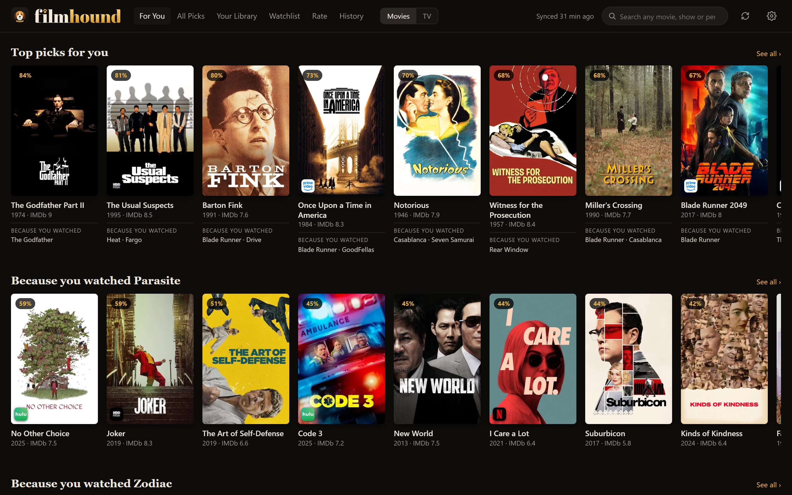

 
<picture><source media="(prefers-color-scheme: dark)" srcset="../icons/filmhound-wordmark.svg"></picture>

Movie and TV recommendations built from your Plex library and watch history. Browse picks, see why each one was picked, and send what you want to Radarr, Sonarr or Seerr. Nothing is requested automatically.

I built Filmhound because the recommendation apps I tried never matched what was in my library or what I was watching. It starts from your own library, explains every pick, and lets you tune how it decides.

## What you need

- A Plex server and its token
- A free TMDB API key ([themoviedb.org/settings/api](https://www.themoviedb.org/settings/api))
- Optional: Seerr (Overseerr/Jellyseerr), Radarr, Sonarr, a Letterboxd account, a Trakt account

## Setup

When installing, Community Apps asks which version you want: **Latest** (stable releases, recommended) or **Nightly** (built every night from the newest code, with new features first and the occasional bug). You can switch any time by editing the container and changing the tag at the end of Repository, for example `ghcr.io/shaderf/filmhound:latest`. Your settings and data carry over. Two more tags exist for special cases: an exact version such as `:0.10.0` to stay on one release or roll back if a release causes trouble, and `:edge`, test builds published while changes are being tried out (expect rough edges).

1. Install from Community Apps and open the WebUI (`http://SERVER-IP:8788`).
2. A short setup walkthrough opens on first start. Enter your Plex URL and token, then your TMDB key, and use **Test** on each. Afterwards, the **Getting started** list on the home page points to the optional extras. Everything can be changed later in Settings.
3. The first sync reads your library and looks up every title on TMDB. A few thousand titles take a few minutes; after that, syncs are quick and run nightly.

**Finding your Plex token:** Plex Web → any movie → ⋯ → Get Info → View XML. The token is the `X-Plex-Token=` value in the page address.

## What's in it

- **For You**: rows like *Because you watched…*, *Because you have…*, themed rows, hidden gems, your watchlist, *Finish what you started* (missing films from collections and directors you own) and *Coming soon* from people you like.
- **All Picks**: every pick, endlessly, with filters for genres, years, rating, runtime, language, network and your streaming services.
- **Your Library**: what you own but haven't watched, ranked for you. Send the top 50 to a Plex collection.
- **Rate**: rate what you've watched, one at a time. Ratings on titles in Plex are saved to Plex.
- **Title pages**: trailer, where to stream, cast and crew, and why it was picked. Add to Radarr or Sonarr, request through Seerr, save to your watchlist, or open *More like this*.
- **Search** any movie, show or person.
- **History from elsewhere**: Letterboxd and Trakt, optionally copied into Plex ratings. For Letterboxd, upload your export once (letterboxd.com → Settings → Data → Export your data) to bring in your full history and every rating. Your username alone only reads your diary feed, which holds just your latest ~50 entries; it keeps things current after the export.
- **Don't learn from**: keep kids' movies or someone else's shows in Plex without them shaping your picks.

## How it picks

Your ratings count most, then what you've watched, then what you own (adjustable). Each title in your library points to others through TMDB's recommendations; Filmhound adds a taste profile of the directors, writers, cast, keywords, genres, decades and franchises you return to, plus IMDb ratings for quality.

## HTTPS

Either works:

- **Reverse proxy (recommended):** put the app behind Nginx Proxy Manager, SWAG, Caddy, Traefik, or `tailscale serve`, and let it handle certificates. Proxies on your own network are trusted automatically, so the app knows it's on HTTPS (sign-in cookies are then marked secure). Serve it at the root of a domain or subdomain, e.g. `https://filmhound.example.com`; a sub-path like `/filmhound` isn't supported.
- **Built-in:** put a certificate and key in the Data folder (e.g. `certs/cert.pem` and `certs/key.pem`), then set **HTTPS certificate** to `/data/certs/cert.pem` and **HTTPS key** to `/data/certs/key.pem` in the container's advanced settings. Restart after renewing a certificate. With Tailscale, `tailscale cert` creates both files for your server's `ts.net` name.

If you turn on HTTPS, also turn on sign-in in Settings before reaching the app from outside your home.

## Tips

- Rating things is the biggest lever. The **Rate** page makes it quick.
- Too many obscure picks? Raise *Minimum TMDB votes* in Settings. Too mainstream? Lower it.
- Your data is in the Data folder (`filmhound.db`, `settings.json`). Delete both to start fresh.

*Filmhound and Recordhound are named for Daisy, my beagle and the hound of my life.*

## Source code and help

Filmhound is open source under the AGPL-3.0: [github.com/ShadeRF/filmhound](https://github.com/ShadeRF/filmhound). Report problems or suggest ideas in its [issues](https://github.com/ShadeRF/filmhound/issues).
