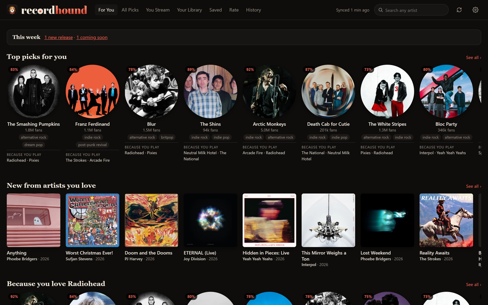

 
<picture><source media="(prefers-color-scheme: dark)" srcset="../icons/recordhound-wordmark.svg"></picture>

Music recommendations built from your Plex library and listening history. Browse new artists, see why each one was picked, preview them, and send what you want to Lidarr. Nothing is downloaded automatically.

I built Recordhound because I listen both to my own library and on streaming services, and no recommendation app I tried took both into account. It combines your Plex library with your listening elsewhere, explains every pick, and lets you tune how it decides.

## What you need

- A Plex server with a music library, and its token
- Optional: a ListenBrainz account with your scrobbles (free, and works with most streaming services), Spotify, YouTube Music, Lidarr, and a Last.fm API key (see [Last.fm](#lastfm))

## Setup

When installing, Community Apps asks which version you want: **Latest** (stable releases, recommended) or **Nightly** (built every night from the newest code, with new features first and the occasional bug). You can switch any time by editing the container and changing the tag at the end of Repository, for example `ghcr.io/shaderf/recordhound:latest`. Your settings and data carry over. Two more tags exist for special cases: an exact version such as `:0.14.0` to stay on one release or roll back if a release causes trouble, and `:edge`, test builds published while changes are being tried out (expect rough edges).

1. Install from Community Apps and open the WebUI (`http://SERVER-IP:8789`).
2. A short setup walkthrough opens on first start. Enter your Plex URL and token and use **Test connection**, then choose how each music library is used: **Use**, **Own only** (counts as yours but doesn't shape your picks) or **Ignore**. Everything else is optional: the **Getting started** list on the home page points to the extras, and everything can be changed later in Settings.
3. The first sync looks up every artist and can take 20 minutes or more, since MusicBrainz allows one lookup a second. Lookups are cached for a month, so later syncs are quick. Syncs run nightly.

## What's in it

- **For You**: a *This week* summary, top picks (reshuffled weekly), *New for you this week*, *Because you play…*, genre rows, deep cuts, new releases from artists you love (including announced albums), albums you're missing, and albums you own but never played.
- **All Picks**: every pick, endlessly, with genre include/exclude and filters for how well known an artist is.
- **Your Library**: albums you own but have never played, ranked for you with a reason for each. One click puts the top ones in a Plex playlist for Plexamp. Soundtracks and compilations are included, ranked by the artists on them (you can turn that off in Settings → Plex).
- **Missing**: everything that isn't yours yet, in four views. **Artists**: artists you play a lot on ListenBrainz, Spotify, YouTube Music or Last.fm but don't own; send them to Lidarr from here. **Liked songs**: songs you've liked on Spotify that aren't in Plex, newest like first, and can be grouped by album or artist; send a single, EP or album to Lidarr (only that release is monitored), or make a Plex playlist of the liked songs you do own (needs the Spotify account connection). **Albums**: albums you're missing from artists you already collect, with options to include EPs, remixes, live albums, compilations and reissues. **New releases** from artists you love, including announced albums.
- **Rate**: rate the artists you play, one at a time. Ratings go to Plex. Rate picks you already know so they stop being suggested, or press K to mark them known without a rating.
- **Artist pages**: songs to play, why it was picked, bio, albums (owned ones marked), similar artists, and links to Spotify, Apple Music, Bandcamp and more. Click an album for its tracks (✓ for ones you own, ♥ for ones you've liked on Spotify), and open it in Plex, add it to Lidarr or play it on Spotify.
- **Lidarr**: add artists with your quality and metadata profiles and choose what to monitor.
- **Save**, **Not interested**, **Already know them**, and **Don't learn from** (for kids' music, someone else's albums, soundtracks and compilations, or any genre in your library). Each Plex library can be set to **Use**, **Own only** (counts as yours but doesn't shape your picks) or **Ignore** on the Plex card in Settings.

## Listening history

Plex play counts (including Plexamp) and star ratings are always used. Optionally add:

- **ListenBrainz** (free): enter your username (your profile must be public). This is also the way in for Apple Music, YouTube Music, Deezer, Tidal and other services; see below.
- **Spotify history file**: request your data at [spotify.com/account/privacy](https://www.spotify.com/account/privacy/) and upload the zip Spotify emails you. No developer account needed.
- **Spotify account**: keeps your top, followed and saved artists and your Liked Songs current. Spotify only allows this through a personal developer app: create one at [developer.spotify.com/dashboard](https://developer.spotify.com/dashboard) with the redirect URI `https://shaderf.github.io/recordhound-auth/`, paste its Client ID in Settings, click **Connect Spotify** and approve. You come straight back. (That address is a small page that sends you back to your own Recordhound; [how it works](https://github.com/ShadeRF/recordhound-auth).) If you connected Spotify before this was possible, see the note in Settings → Spotify. Spotify requires Premium for developer apps, limits each to 5 users, and ends connections after six months.
- **YouTube Music history file**: at [takeout.google.com](https://takeout.google.com), click **Deselect all**, tick **YouTube and YouTube Music**, and under *All YouTube data included* keep only **history**. Upload the zip Google emails you in Settings → YouTube Music. Only YouTube Music plays count, not regular YouTube videos.
- **Last.fm**: enter your username. This needs a Last.fm API key, and from December 1, 2026 the key's account needs Last.fm Pro.

**Playing full songs:** with the Spotify account connected, play buttons play the whole song in your Spotify app: the one on your computer, or on your phone when you're browsing on your phone (never a speaker or receiver). Otherwise you hear 30-second previews. This needs Spotify Premium. If you connected Spotify before 0.14.0, click **Reconnect** in Settings → Spotify once to allow it. You can turn it off there to keep previews.

**Listening on other services:** Recordhound doesn't connect to Apple Music, Deezer or Tidal directly, but ListenBrainz can collect your plays from them (and from YouTube Music, to keep it current between uploads) for free. The [Web Scrobbler](https://web-scrobbler.com) browser extension sends what you play in a service's web player (not its phone or desktop app), and [multi-scrobbler](https://github.com/FoxxMD/multi-scrobbler) runs on your server and collects plays from several services and players. Then add your ListenBrainz username in Settings. Plays count from the day you set this up.

## How it picks

Your star ratings count most, then how much you play an artist anywhere, then what you own (adjustable). Artists you've played in the last six months get extra pull (adjustable under *What you've played lately*). Recordhound walks similar-artist data out from your strongest artists, scores candidates against a profile of the genres and scenes you return to, and explains each pick with the artists that led to it.

### Where artist data comes from

By default, similar artists come from ListenBrainz (what its listeners play together) and Deezer (related artists), genre tags from MusicBrainz, fan counts from Deezer, and bios from Wikipedia. None of these need a key.

**Last.fm:** if you enter a Last.fm API key, Recordhound uses Last.fm's similar artists, tags and listener counts instead, and can read your scrobbles. From December 1, 2026, Last.fm keys only work while the account that owns the key has Last.fm Pro. If your key stops working, Recordhound switches to the free sources on its own and shows a warning; clear the key in Settings to make that permanent.

## HTTPS

Either works:

- **Reverse proxy (recommended):** put the app behind Nginx Proxy Manager, SWAG, Caddy, Traefik, or `tailscale serve`, and let it handle certificates. Proxies on your own network are trusted automatically, so the app knows it's on HTTPS (sign-in cookies are then marked secure). Serve it at the root of a domain or subdomain, e.g. `https://recordhound.example.com`; a sub-path like `/recordhound` isn't supported.
- **Built-in:** put a certificate and key in the Data folder (e.g. `certs/cert.pem` and `certs/key.pem`), then set **HTTPS certificate** to `/data/certs/cert.pem` and **HTTPS key** to `/data/certs/key.pem` in the container's advanced settings. Restart after renewing a certificate. With Tailscale, `tailscale cert` creates both files for your server's `ts.net` name.

If you turn on HTTPS, also turn on sign-in in Settings before reaching the app from outside your home.

## Tips

- Rating artists is the biggest lever. The **Rate** page makes it quick.
- Raise *Minimum Deezer fans* (or *Minimum Last.fm listeners* with a Last.fm key) in Settings for better-known picks, or lower it and use **Deep cuts** for obscure ones.
- Songs and albums are matched even when names differ a little: brackets, featured artists, styled names like CHVRCHΞS.
- Your data is in the Data folder (`recordhound.db`, `settings.json`). Delete both to start fresh.

*Filmhound and Recordhound are named for Daisy, my beagle and the hound of my life.*

## Source code and help

Recordhound is open source under the AGPL-3.0: [github.com/ShadeRF/recordhound](https://github.com/ShadeRF/recordhound). Report problems or suggest ideas in its [issues](https://github.com/ShadeRF/recordhound/issues).
